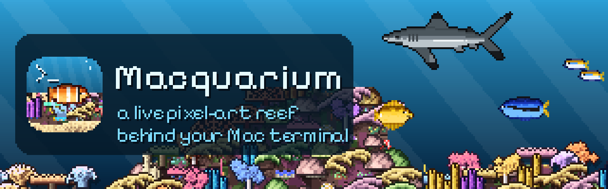
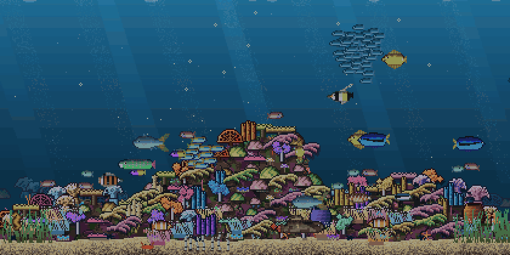
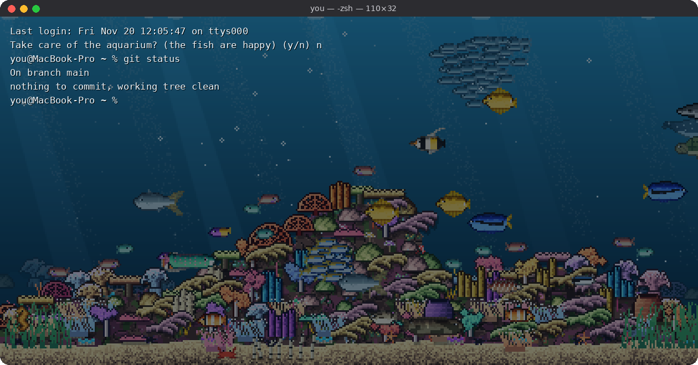
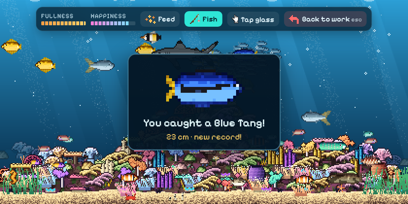
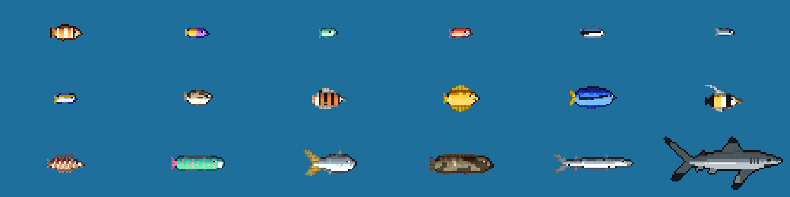

<p align="center">
  
</p>

<p align="center">
  
  
  
  
</p>

<p align="center"><b>Turn every Terminal window into a living coral reef.</b><br>
Hand-drawn pixel fish swim behind your text while you work. Feed them, fish for them, and give the window a shake.</p>

<p align="center">
  
</p>

---

## ✨ Features

- **A real aquarium behind your text.** A live pixel-art reef sits directly behind every Terminal window and follows it as you move and resize. It stays until you uninstall.
- **Original pixel art.** 21 hand-drawn creatures:
  - small reef fish: clownfish, blue and yellow tangs, Moorish idol, copperband butterflyfish, royal gramma, anthias, chromis, cleaner wrasse, parrotfish, lionfish, puffer, grouper
  - big swimmers: barracuda, giant trevally, a blacktip reef shark, a sea turtle, an eagle ray
  - schools of sardines and fusiliers
  - a seahorse
- **A reef that's alive.** Garden eels pop out of the sand and duck when fish get close. A crab wanders the bottom. Seagrass and anemones sway, sunlight ripples over the coral, specks drift through the water, and a far-off reef fades into the blue.
- **Take care of them.** Each new Terminal window asks `Take care of the aquarium? (y/n)`. Press **n** to get straight back to work, or **y** to play:
  - **Feed:** click the water to drop food. The fish race for it.
  - **Fish:** move the hook around with your mouse until something bites. Then fight it: hold the mouse button to reel, and let go when it runs or the line turns red. Land it to see what you caught and how big, with personal records. Then it goes back in the tank.
  - **Tap glass:** your cursor becomes a pointing hand. Tap to startle the fish.
- **Shake it.** Grab a Terminal window and shake it. The water sloshes, fish get flung about, sand and bubbles kick up, and the eels hide. The fish get seasick if you overdo it.
- **Your fish remember.** Fullness and happiness change in real time, even when your Mac is off.
- **Doesn't get in your way.** Your prompt is left alone. The tank is dimmed behind your text, hides in Mission Control, and has rounded corners to match your windows. Brightness is one click away in the menu bar (look for the little sketched fish).

<p align="center">
  
  
</p>

## 🚀 Install

```bash
git clone https://github.com/YOUR_GITHUB_USERNAME/macquarium.git
cd macquarium
./install.sh
```

The installer builds the small tank app on your Mac. That needs Apple's free Command Line Tools; if you don't have them, a window pops up to install them. Once that finishes, run `./install.sh` again. At the end it asks **"Release the fish now?"**

> The first time, macOS may ask whether Terminal can control Terminal (Automation). Click **OK**. That's how Macquarium switches your Terminal profile to the see-through one.

## 🕹️ Commands

| Command | What it does |
| --- | --- |
| `macquarium on` | Start the tank behind your Terminal windows |
| `macquarium off` | Stop it and restore your old profile (the fish wait for you) |
| `macquarium care` | Feed, fish and play any time |
| `macquarium ask off` | Stop the startup question (`ask on` brings it back) |
| `macquarium status` | Is it on, and how full and happy are the fish |
| `macquarium corners 16` | Match the tank's rounded corners to your windows |
| `macquarium doctor` | Status plus the app log, for troubleshooting |
| `macquarium swim` | The old-school text aquarium, right in the terminal |
| `macquarium uninstall` | Remove everything |

The **sketched fish in your menu bar** has tank brightness (Bright / Normal / Dim / Very dim), **Hide the tank**, and Quit.

## 🐟 The fish

<p align="center"></p>

## 🛠️ How it works

| Piece | What it does |
| --- | --- |
| `app/main.swift` | A tiny menu-bar app. It watches your Terminal windows and keeps a borderless, rounded window glued directly behind each one, following moves and resizes. Moving without resizing counts as a shake. It starts at login with a LaunchAgent. |
| `app/tank/` | The tank itself: a canvas engine (`tank.js`) drawing pixel art at 1:1 and scaling it up with no smoothing. It handles schools (boids), reef hovering, shark patrols, feeding, fishing, shaking, and hunger and happiness. |
| `themes/` | The "Macquarium-Reef" Terminal profile, with a 12%-opaque background so the reef shows through. |
| `art/` | Python scripts that generate all the art: `sprites.py` (fish), `reef.py` (coral reef), `creatures.py`, `brand.py` (logo, icon, banner) and `export_atlas.py`. |
| `bin/macquarium` | The CLI (bash 3.2, no dependencies). |
| `shell/` | The zsh/bash startup question. |

**Change the art:**

```bash
pip3 install pillow numpy fonttools brotli
cd art && python3 reef.py && python3 export_atlas.py && python3 brand.py
cd .. && ./install.sh
```

**Privacy:** Macquarium only reads *where* Terminal's windows are, never what's in them. It doesn't need Screen Recording or Accessibility permission.

## ❓ Troubleshooting

- **No reef behind the text:** run `macquarium doctor` and check the log. Crash reports live in `~/Library/Logs/DiagnosticReports/Macquarium-*.ips`.
- **Corners poke out:** try `macquarium corners 12` or `macquarium corners 20`.
- **Text hard to read:** menu bar fish → Tank brightness → **Dim**.
- **Other terminals:** the live tank is for Terminal.app. In iTerm2 and others you still get `macquarium swim`, and you can import `themes/Macquarium.itermcolors`.

## 🙏 Credits

- All fish, coral and UI art is original pixel art made for Macquarium.
- The UI font is [Pixelify Sans](https://github.com/eifetx/Pixelify-Sans), under the SIL Open Font License (`app/tank/fonts/OFL.txt`).

## 📄 License

MIT © Coops
