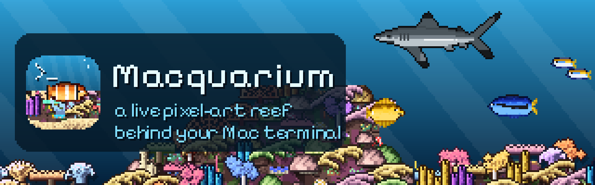

# v1.0.0: Release the Fish 🐠

The first public release of **Macquarium**: a live pixel-art coral reef that lives behind your Mac terminal.



## Highlights

- **A live reef behind every Terminal window.** It's glued behind each window, follows moves and resizes, has rounded corners and hides in Mission Control.
- **21 original pixel-art creatures**, including a blacktip reef shark, sea turtle, eagle ray, schools of sardines and fusiliers, and clownfish living in their anemones.
- **A living reef.** It has garden eels, a wandering crab, swaying seagrass and anemones, rippling sunlight, drifting particles and a far reef fading into the blue.
- **Care mode.** Every new Terminal window asks *"Take care of the aquarium? (y/n)"*:
  - **Feed:** click to drop food.
  - **Fish:** move the hook to a fish, fight it with line tension and reeling, land it for a catch card with personal records, then it's thrown back.
  - **Tap glass:** your cursor becomes a pointing hand.
- **Shake to slosh.** Shake a Terminal window and the tank sloshes, fish get flung about, sand and bubbles kick up, and the eels hide.
- **Hunger and happiness** persist and change in real time.
- **Stays out of your way.** Your prompt is left alone, the tank is dimmed behind your text, and brightness is in the 🐠 menu bar.

## Install

```bash
git clone https://github.com/YOUR_GITHUB_USERNAME/macquarium.git
cd macquarium && ./install.sh
```

Requires macOS 11+ and Apple's Command Line Tools (the installer prompts for them). It's built and tested on macOS 27.

## Commands

`macquarium on` · `off` · `care` · `ask on|off` · `status` · `corners N` · `doctor` · `swim` · `uninstall`

## Known limitations

- The live tank is for Terminal.app only. Other terminals get `macquarium swim` and the colour theme.
- The corner radius is a fixed 16 by default. If it doesn't line up with your windows, use `macquarium corners N`.
